# Map of the series (generated by `tools/atlas.py render`; do not edit)

Solid arrow: s (read first). Dashed arrow: b (a named result is borrowed; reading its chapter is optional). see and revisits are not drawn. The diagrams are transitively reduced for legibility; every direct edge is in the registry and in `atlas.html`. For the interactive map, open `atlas.html` in a browser.

## Volumes

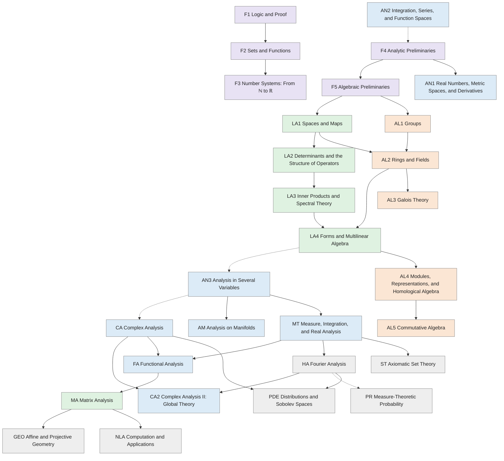

## F1 Logic and Proof

```mermaid
flowchart LR
  F1_1["1 Connectives and Derivations"]
  F1_2["2 Negation and Classical Logic"]
  F1_7["7 Finding Derivations"]
  F1_3["3 Truth, Soundness, and Completeness"]
  F1_4["4 Predicate Logic and the Quantifier Rules"]
  F1_8["8 Working with Quantifiers: Translation, Laws, and Search"]
  F1_6["6 Models and Theories"]
  F1_5["5 From Derivations to Mathematical Prose"]
  F1_1 --> F1_2
  F1_2 --> F1_7
  F1_7 --> F1_3
  F1_3 --> F1_4
  F1_4 --> F1_8
  F1_8 --> F1_6
  F1_6 -.-> F1_5
  classDef ext fill:#e6e6e6,stroke:#999,color:#555
  classDef opt fill:#fff,stroke:#999,stroke-dasharray:4 3,color:#555
  classDef segb fill:#f6f6fb,stroke:#99a,color:#333
```

## F2 Sets and Functions


## F3 Number Systems: From ℕ to ℝ

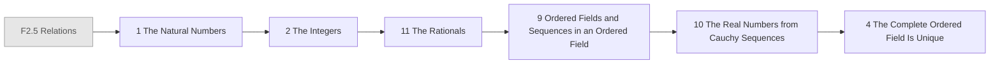

## F4 Analytic Preliminaries

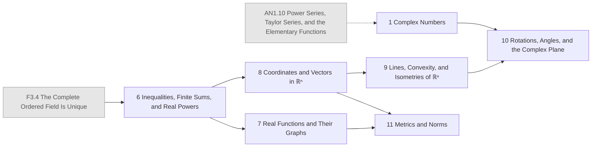

## F5 Algebraic Preliminaries

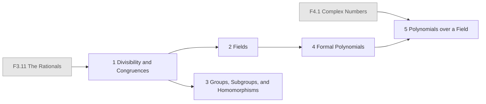

## AN1 Real Numbers, Metric Spaces, and Derivatives

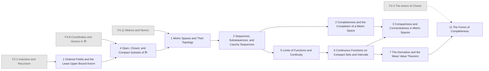

## LA1 Spaces and Maps

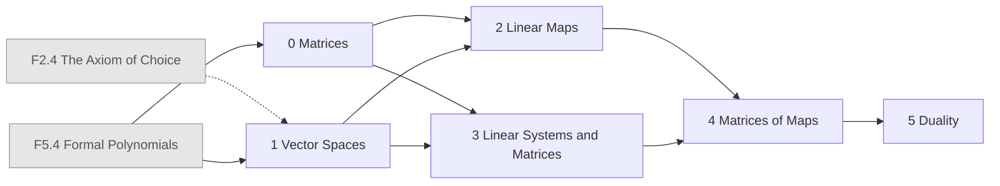

## AL1 Groups

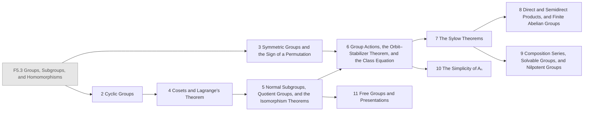

## LA2 Determinants and the Structure of Operators

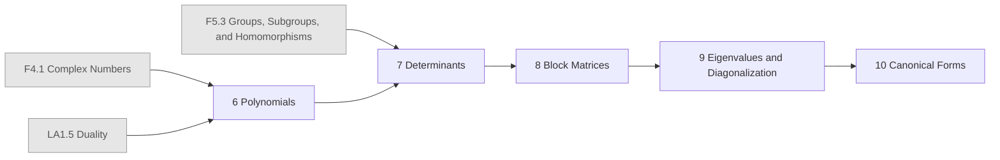

## LA3 Inner Products and Spectral Theory

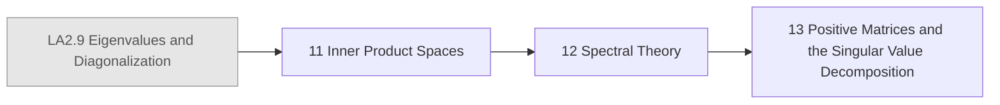

## AL2 Rings and Fields

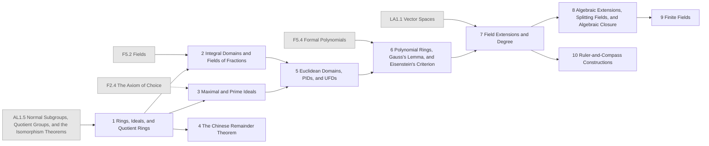

## LA4 Forms and Multilinear Algebra

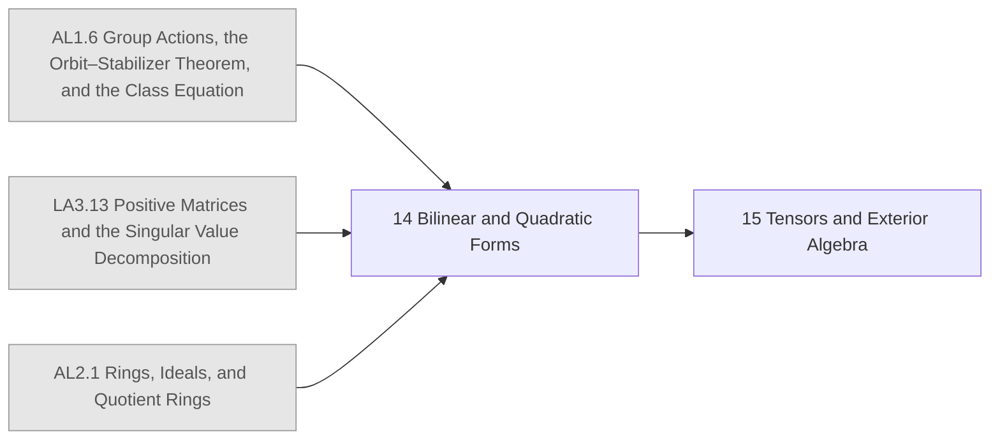

## AN2 Integration, Series, and Function Spaces

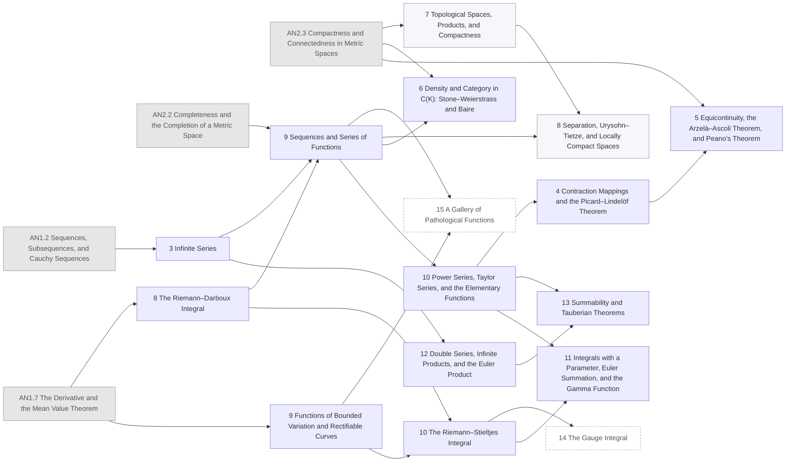

## AN3 Analysis in Several Variables

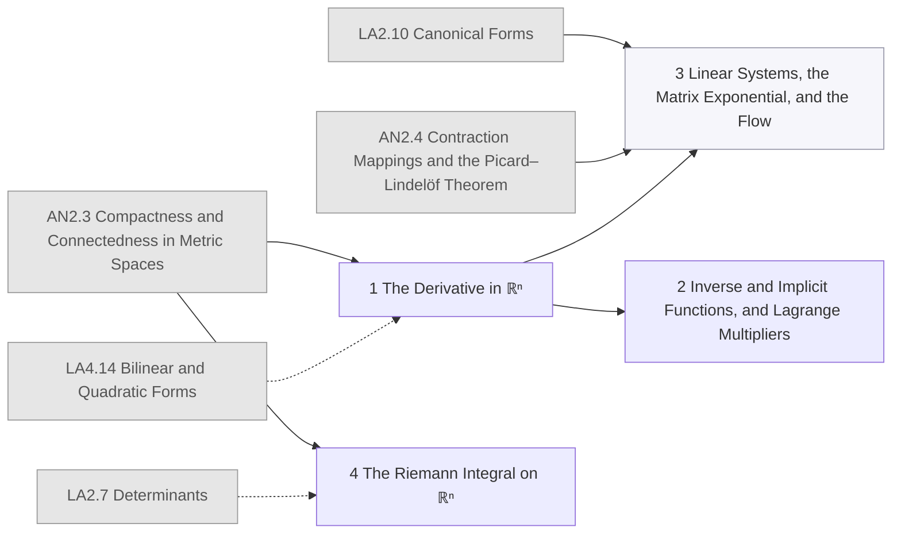

## CA Complex Analysis

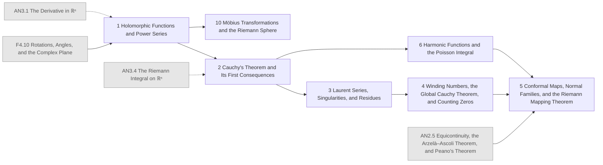

## AL3 Galois Theory

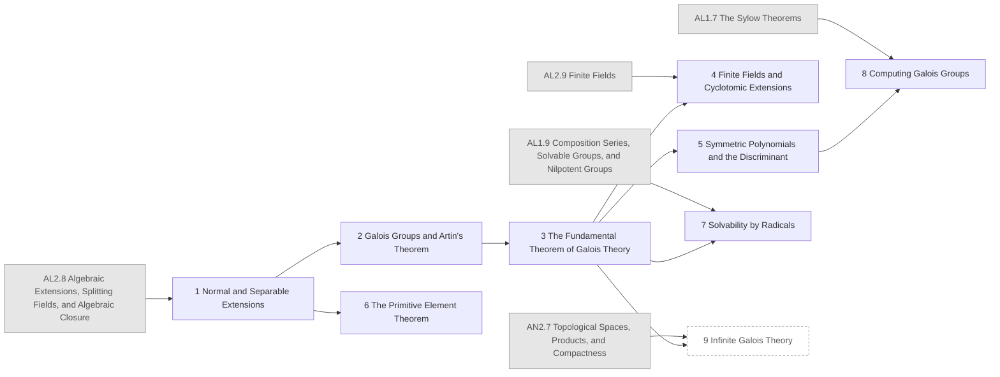

## CA2 Complex Analysis II: Global Theory

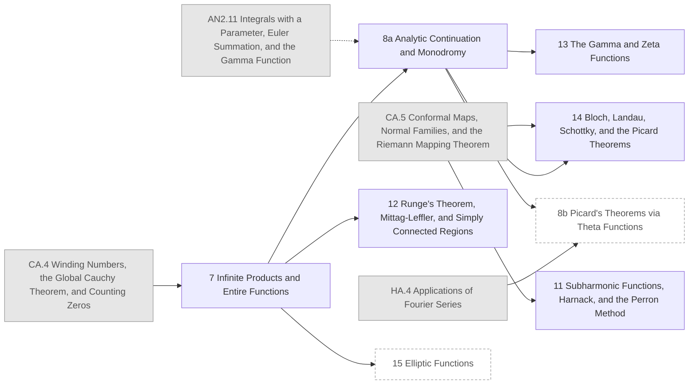

## AM Analysis on Manifolds

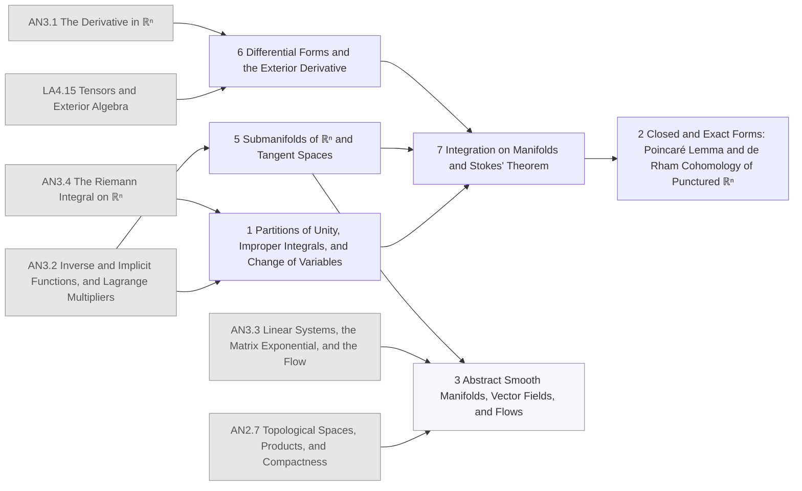

## MT Measure, Integration, and Real Analysis

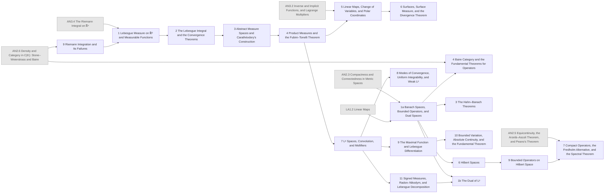

## FA Functional Analysis

```mermaid
flowchart LR
  AN2_7["AN2.7 Topological Spaces, Products, and Compactness"]:::ext
  AN2_8["AN2.8 Separation, Urysohn–Tietze, and Locally Compact Spaces"]:::ext
  CA_2["CA.2 Cauchy's Theorem and Its First Consequences"]:::ext
  CA_5["CA.5 Conformal Maps, Normal Families, and the Riemann Mapping Theorem"]:::ext
  MT_3["MT.3 Abstract Measure Spaces and Carathéodory's Construction"]:::ext
  FA_1a["FA.1a Banach Spaces, Bounded Operators, and Dual Spaces"]:::ext
  FA_4["FA.4 Baire Category and the Fundamental Theorems for Operators"]:::ext
  FA_3["FA.3 The Hahn–Banach Theorems"]:::ext
  FA_1b["FA.1b The Dual of Lᵖ"]:::ext
  FA_7["FA.7 Compact Operators, the Fredholm Alternative, and the Spectral Theorem"]:::ext
  FA_2["2 Radon Measures and the Dual of C₀(X)"]
  FA_5["5 Weak Topologies, Tychonoff, and Banach–Alaoglu"]
  FA_10["10 Reflexivity, Uniform Convexity, and Separability"]
  FA_11["11 Locally Convex Spaces and Fréchet Spaces"]
  FA_8["8 Banach Algebras and Gelfand Theory"]
  FA_12["12 The Spectral Theorem for Bounded Normal Operators"]
  FA_13["13 Unbounded Operators and Self-Adjointness"]
  FA_14["14 Fredholm Operators and the Index"]
  CA_9["9 Positive Harmonic Functions and the Herglotz–Nevanlinna Representation"]:::opt
  AN2_8 --> FA_2
  MT_3 --> FA_2
  FA_1a --> FA_2
  AN2_7 --> FA_5
  FA_4 --> FA_5
  FA_3 --> FA_5
  FA_1b --> FA_10
  FA_5 --> FA_10
  FA_5 --> FA_11
  CA_2 --> FA_8
  FA_7 --> FA_8
  FA_8 --> FA_12
  FA_12 --> FA_13
  FA_4 --> FA_14
  FA_7 --> FA_14
  CA_5 --> CA_9
  FA_2 --> CA_9
  FA_5 --> CA_9
  classDef ext fill:#e6e6e6,stroke:#999,color:#555
  classDef opt fill:#fff,stroke:#999,stroke-dasharray:4 3,color:#555
  classDef segb fill:#f6f6fb,stroke:#99a,color:#333
```

## AL4 Modules, Representations, and Homological Algebra

```mermaid
flowchart LR
  LA1_2["LA1.2 Linear Maps"]:::ext
  LA2_10["LA2.10 Canonical Forms"]:::ext
  AL2_1["AL2.1 Rings, Ideals, and Quotient Rings"]:::ext
  AL2_5["AL2.5 Euclidean Domains, PIDs, and UFDs"]:::ext
  LA4_15["LA4.15 Tensors and Exterior Algebra"]:::ext
  AL4_1["1 Modules, Submodules, Quotients, and Homomorphisms"]
  AL4_2["2 Free Modules, Direct Sums, and Exact Sequences"]
  AL4_3["3 Finitely Generated Modules over a PID"]
  AL4_4["4 Applications: Finitely Generated Abelian Groups and Canonical Forms"]
  AL4_5["5 Tensor Products, Hom, and Adjunction"]
  AL4_6["6 Projective, Injective, and Flat Modules"]
  AL4_7["7 Categories, Functors, and Universal Properties"]
  AL4_8["8 Algebras and Representations"]
  AL4_9["9 Representations of Finite Groups: Maschke and Schur"]
  AL4_10["10 Character Theory"]
  AL4_11["11 Complexes, Homology, Tor, and Ext: An Introduction"]
  LA1_2 --> AL4_1
  AL2_1 --> AL4_1
  AL4_1 --> AL4_2
  LA2_10 --> AL4_3
  AL2_5 --> AL4_3
  AL4_2 --> AL4_3
  AL4_3 --> AL4_4
  AL4_2 --> AL4_5
  AL4_5 --> AL4_6
  AL4_5 --> AL4_7
  LA2_10 --> AL4_8
  LA4_15 --> AL4_8
  AL4_8 --> AL4_9
  AL4_9 --> AL4_10
  AL4_6 --> AL4_11
  AL4_7 --> AL4_11
  classDef ext fill:#e6e6e6,stroke:#999,color:#555
  classDef opt fill:#fff,stroke:#999,stroke-dasharray:4 3,color:#555
  classDef segb fill:#f6f6fb,stroke:#99a,color:#333
```

## AL5 Commutative Algebra

```mermaid
flowchart LR
  AL2_3["AL2.3 Maximal and Prime Ideals"]:::ext
  AL2_6["AL2.6 Polynomial Rings, Gauss's Lemma, and Eisenstein's Criterion"]:::ext
  AL2_7["AL2.7 Field Extensions and Degree"]:::ext
  AL4_2["AL4.2 Free Modules, Direct Sums, and Exact Sequences"]:::ext
  AL5_1["1 Localization and Modules of Fractions"]
  AL5_2["2 Noetherian Rings and the Hilbert Basis Theorem"]
  AL5_3["3 Integral Extensions, Going Up, and Going Down"]
  AL5_4["4 Hilbert's Nullstellensatz"]
  AL5_5["5 Primary Decomposition"]
  AL5_6["6 Dedekind Domains"]
  AL5_7["7 Krull Dimension: An Introduction"]
  AL2_3 --> AL5_1
  AL4_2 --> AL5_1
  AL2_6 --> AL5_2
  AL4_2 --> AL5_2
  AL2_7 --> AL5_3
  AL5_1 --> AL5_3
  AL5_2 --> AL5_4
  AL5_3 --> AL5_4
  AL5_1 --> AL5_5
  AL5_2 --> AL5_5
  AL5_2 --> AL5_6
  AL5_3 --> AL5_6
  AL5_4 --> AL5_7
  classDef ext fill:#e6e6e6,stroke:#999,color:#555
  classDef opt fill:#fff,stroke:#999,stroke-dasharray:4 3,color:#555
  classDef segb fill:#f6f6fb,stroke:#99a,color:#333
```

## MA Matrix Analysis

```mermaid
flowchart LR
  AN2_3["AN2.3 Compactness and Connectedness in Metric Spaces"]:::ext
  AN1_11["AN1.11 The Forms of Completeness"]:::ext
  LA2_10["LA2.10 Canonical Forms"]:::ext
  LA3_13["LA3.13 Positive Matrices and the Singular Value Decomposition"]:::ext
  AN3_3["AN3.3 Linear Systems, the Matrix Exponential, and the Flow"]:::ext
  CA_9["CA.9 Positive Harmonic Functions and the Herglotz–Nevanlinna Representation"]:::ext
  MA_16["16 Norms and Matrix Analysis"]
  MA_17["17 Variational Principles and Interlacing"]
  MA_18["18 Convexity"]
  MA_19["19 Nonnegative Matrices"]
  MA_20["20 Perturbation Theory"]
  MA_21["21 Matrix Inequalities"]
  MA_21b["21b Löwner's Theorem in Pick-Function Form"]:::opt
  AN2_3 -.-> MA_16
  AN1_11 -.-> MA_16
  LA2_10 --> MA_16
  LA3_13 --> MA_16
  MA_16 --> MA_17
  MA_17 --> MA_18
  MA_18 --> MA_19
  MA_19 --> MA_20
  AN3_3 -.-> MA_21
  MA_20 --> MA_21
  CA_9 --> MA_21b
  MA_21 --> MA_21b
  classDef ext fill:#e6e6e6,stroke:#999,color:#555
  classDef opt fill:#fff,stroke:#999,stroke-dasharray:4 3,color:#555
  classDef segb fill:#f6f6fb,stroke:#99a,color:#333
```

## HA Fourier Analysis

```mermaid
flowchart LR
  F4_1["F4.1 Complex Numbers"]:::ext
  LA3_11["LA3.11 Inner Product Spaces"]:::ext
  LA3_12["LA3.12 Spectral Theory"]:::ext
  AN2_9["AN2.9 Functions of Bounded Variation and Rectifiable Curves"]:::ext
  AN3_4["AN3.4 The Riemann Integral on ℝⁿ"]:::ext
  MT_7["MT.7 Lᵖ Spaces, Convolution, and Mollifiers"]:::ext
  FA_6["FA.6 Hilbert Spaces"]:::ext
  HA_1["1 Fourier Series: Origins and Basic Properties"]
  HA_2["2 Good Kernels, Summability, and Fejér's Theorem"]
  HA_3["3 Mean-Square and Pointwise Convergence"]
  HA_4["4 Applications of Fourier Series"]
  HA_5["5 The Fourier Transform on ℝ"]
  HA_6["6 The Fourier Transform on ℝᵈ and the Wave Equation"]
  HA_7["7 Fourier Analysis on Finite Abelian Groups"]:::opt
  HA_8["8 Dirichlet's Theorem on Primes in Arithmetic Progressions"]:::opt
  HA_10["10 Fourier Analysis in L¹ and L²"]
  F4_1 --> HA_1
  HA_1 --> HA_2
  LA3_11 --> HA_3
  AN2_9 -.-> HA_3
  HA_2 --> HA_3
  HA_3 --> HA_4
  AN3_4 --> HA_5
  HA_2 --> HA_5
  HA_5 --> HA_6
  LA3_12 --> HA_7
  HA_3 --> HA_7
  HA_7 --> HA_8
  MT_7 --> HA_10
  FA_6 --> HA_10
  HA_3 --> HA_10
  classDef ext fill:#e6e6e6,stroke:#999,color:#555
  classDef opt fill:#fff,stroke:#999,stroke-dasharray:4 3,color:#555
  classDef segb fill:#f6f6fb,stroke:#99a,color:#333
```

## PR Measure-Theoretic Probability

```mermaid
flowchart LR
  MT_8["MT.8 Modes of Convergence, Uniform Integrability, and Weak Lᵖ"]:::ext
  FA_6["FA.6 Hilbert Spaces"]:::ext
  MT_11["MT.11 Signed Measures, Radon–Nikodym, and Lebesgue Decomposition"]:::ext
  HA_6["HA.6 The Fourier Transform on ℝᵈ and the Wave Equation"]:::ext
  PR_1["1 Probability on Measure Spaces"]
  PR_2["2 Conditional Expectation"]
  PR_3["3 Discrete-Time Martingales"]
  PR_4["4 Weak Convergence and Characteristic Functions"]
  PR_5["5 Brownian Motion"]
  MT_8 --> PR_1
  MT_11 --> PR_2
  PR_1 --> PR_2
  PR_2 --> PR_3
  HA_6 -.-> PR_4
  PR_1 --> PR_4
  FA_6 --> PR_5
  PR_3 --> PR_5
  PR_4 --> PR_5
  classDef ext fill:#e6e6e6,stroke:#999,color:#555
  classDef opt fill:#fff,stroke:#999,stroke-dasharray:4 3,color:#555
  classDef segb fill:#f6f6fb,stroke:#99a,color:#333
```

## PDE Distributions and Sobolev Spaces

```mermaid
flowchart LR
  AN2_5["AN2.5 Equicontinuity, the Arzelà–Ascoli Theorem, and Peano's Theorem"]:::ext
  CA_4["CA.4 Winding Numbers, the Global Cauchy Theorem, and Counting Zeros"]:::ext
  MT_6["MT.6 Surfaces, Surface Measure, and the Divergence Theorem"]:::ext
  FA_4["FA.4 Baire Category and the Fundamental Theorems for Operators"]:::ext
  MT_7["MT.7 Lᵖ Spaces, Convolution, and Mollifiers"]:::ext
  MT_8["MT.8 Modes of Convergence, Uniform Integrability, and Weak Lᵖ"]:::ext
  MT_10["MT.10 Bounded Variation, Absolute Continuity, and the Fundamental Theorem"]:::ext
  FA_1b["FA.1b The Dual of Lᵖ"]:::ext
  FA_7["FA.7 Compact Operators, the Fredholm Alternative, and the Spectral Theorem"]:::ext
  HA_6["HA.6 The Fourier Transform on ℝᵈ and the Wave Equation"]:::ext
  PDE_1["1 Distributions"]
  PDE_2["2 Tempered Distributions, the Fourier Transform, and Plancherel"]
  PDE_3["3 Interpolation: Riesz–Thorin, Young, and Hausdorff–Young"]
  PDE_4["4 Sobolev Spaces"]
  PDE_5["5 H¹₀, the Poincaré Inequality, and Rellich Compactness"]
  PDE_6["6 Capstone: The Dirichlet Problem and the Dirichlet-Laplacian Eigenbasis"]
  MT_6 --> PDE_1
  FA_4 --> PDE_1
  MT_7 --> PDE_1
  HA_6 --> PDE_2
  PDE_1 --> PDE_2
  CA_4 --> PDE_3
  MT_8 --> PDE_3
  FA_1b --> PDE_3
  MT_10 --> PDE_4
  PDE_1 --> PDE_4
  AN2_5 --> PDE_5
  PDE_4 --> PDE_5
  FA_7 --> PDE_6
  PDE_5 --> PDE_6
  classDef ext fill:#e6e6e6,stroke:#999,color:#555
  classDef opt fill:#fff,stroke:#999,stroke-dasharray:4 3,color:#555
  classDef segb fill:#f6f6fb,stroke:#99a,color:#333
```

## GEO Affine and Projective Geometry

```mermaid
flowchart LR
  LA4_15["LA4.15 Tensors and Exterior Algebra"]:::ext
  MA_18["MA.18 Convexity"]:::ext
  GEO_22["22 Affine and Projective Geometry"]
  LA4_15 --> GEO_22
  MA_18 --> GEO_22
  classDef ext fill:#e6e6e6,stroke:#999,color:#555
  classDef opt fill:#fff,stroke:#999,stroke-dasharray:4 3,color:#555
  classDef segb fill:#f6f6fb,stroke:#99a,color:#333
```

## NLA Computation and Applications

```mermaid
flowchart LR
  MA_17["MA.17 Variational Principles and Interlacing"]:::ext
  NLA_24["24 Computation and Applications"]
  MA_17 --> NLA_24
  classDef ext fill:#e6e6e6,stroke:#999,color:#555
  classDef opt fill:#fff,stroke:#999,stroke-dasharray:4 3,color:#555
  classDef segb fill:#f6f6fb,stroke:#99a,color:#333
```

## ST Axiomatic Set Theory

```mermaid
flowchart LR
  F2_4["F2.4 The Axiom of Choice"]:::ext
  AL1_6["AL1.6 Group Actions, the Orbit–Stabilizer Theorem, and the Class Equation"]:::ext
  AL1_11["AL1.11 Free Groups and Presentations"]:::ext
  MT_1["MT.1 Lebesgue Measure on ℝᵈ and Measurable Functions"]:::ext
  ST_1["1 The Axioms of ZF"]
  ST_2["2 Ordinals and Transfinite Induction"]
  ST_3["3 Cardinal Arithmetic"]
  ST_4["4 Equivalents of the Axiom of Choice"]
  ST_5["5 The Constructible Universe and Independence: An Overview"]
  ST_6a["6a Vitali's Nonmeasurable Set"]
  ST_6b["6b The Banach–Tarski Paradox"]:::opt
  F2_4 --> ST_1
  ST_1 --> ST_2
  ST_2 --> ST_3
  ST_2 --> ST_4
  ST_4 --> ST_5
  MT_1 --> ST_6a
  AL1_6 --> ST_6b
  AL1_11 --> ST_6b
  ST_6a --> ST_6b
  classDef ext fill:#e6e6e6,stroke:#999,color:#555
  classDef opt fill:#fff,stroke:#999,stroke-dasharray:4 3,color:#555
  classDef segb fill:#f6f6fb,stroke:#99a,color:#333
```

Legend: grey = chapter in another volume; dashed box = optional chapter; lilac = part B (skippable on the main line).
