# 教材地圖（由 `tools/atlas.py render` 產生，勿手改）

實線＝s（需讀），虛線＝b（借用具名結果）。see／revisits 不畫。圖已做傳遞約簡，只為了好讀；
完整的直接邊在 registry 與 `atlas.html`。互動版：用瀏覽器開 `atlas.html`。

## 冊層級

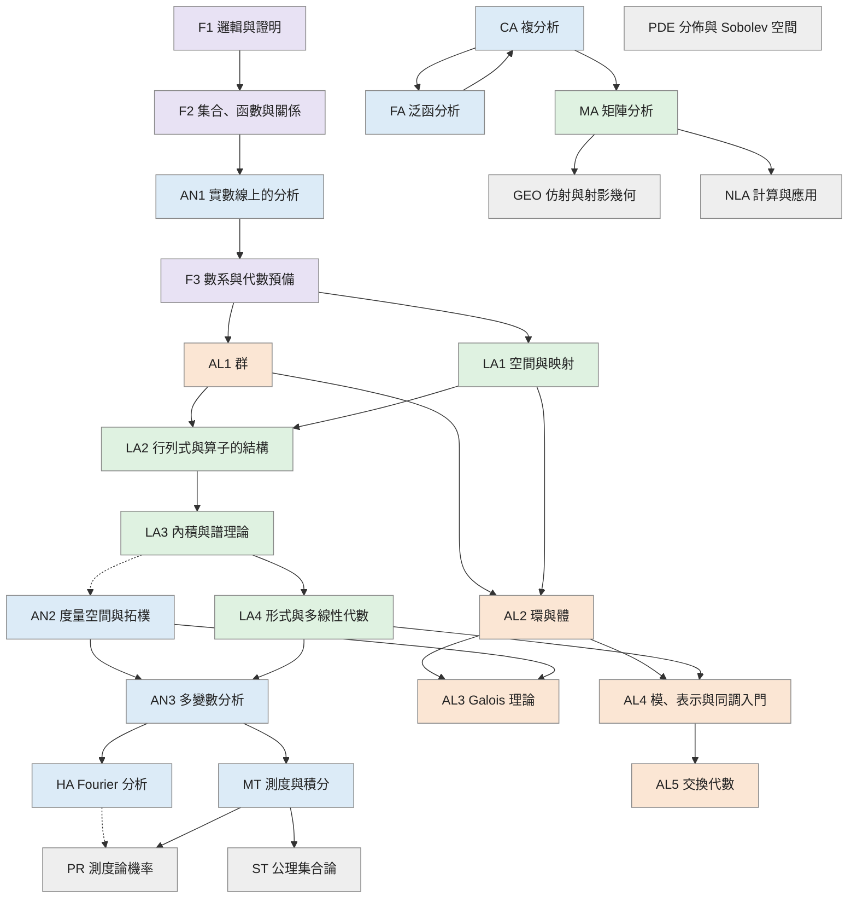

## F1 邏輯與證明

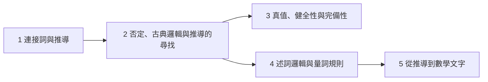

## F2 集合、函數與關係


## AN1 實數線上的分析

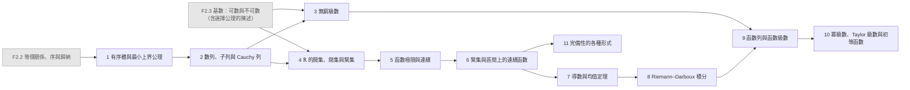

## F3 數系與代數預備

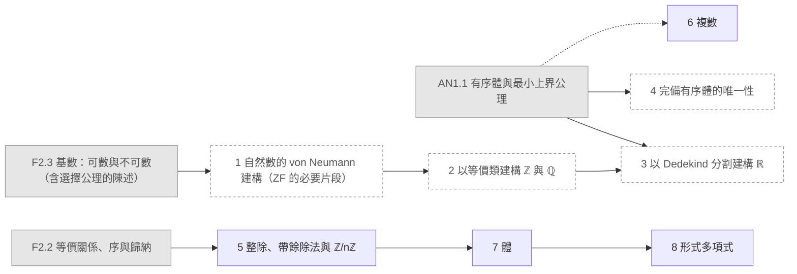

## LA1 空間與映射

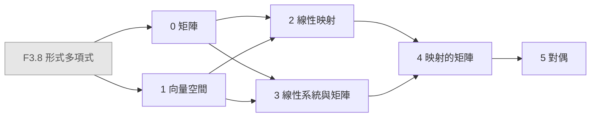

## AL1 群

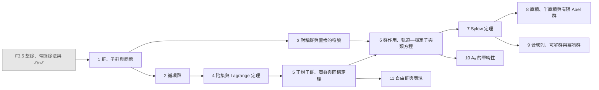

## LA2 行列式與算子的結構

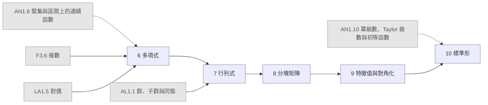

## LA3 內積與譜理論

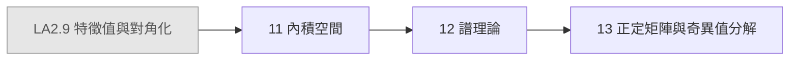

## LA4 形式與多線性代數

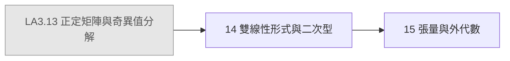

## AN2 度量空間與拓樸

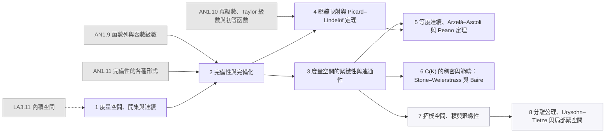

## AN3 多變數分析

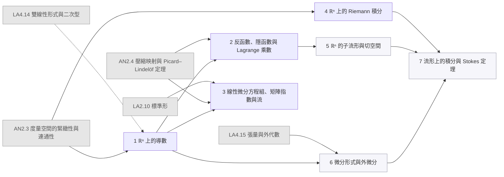

## AL2 環與體

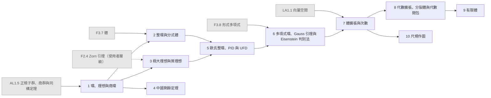

## AL3 Galois 理論

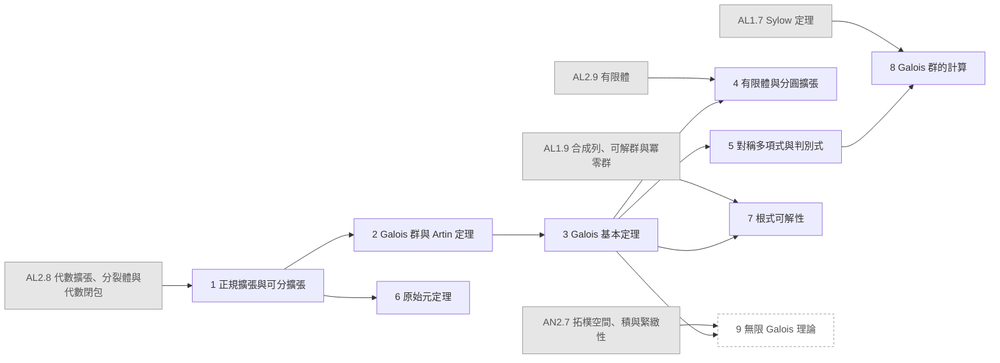

## HA Fourier 分析

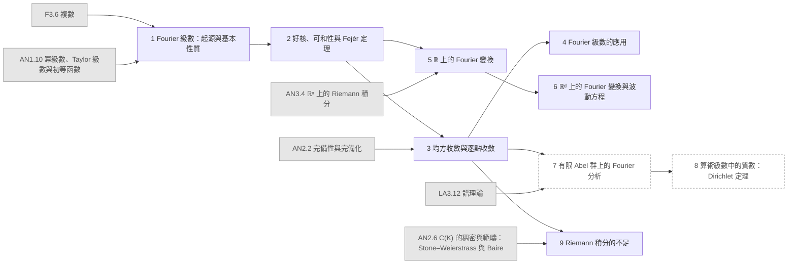

## MT 測度與積分

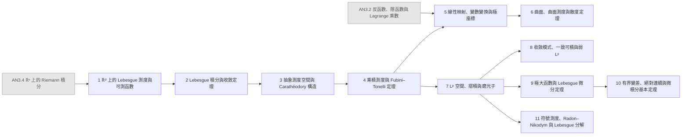

## CA 複分析

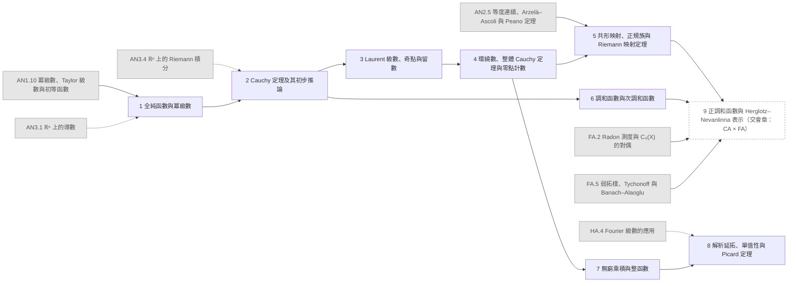

## FA 泛函分析

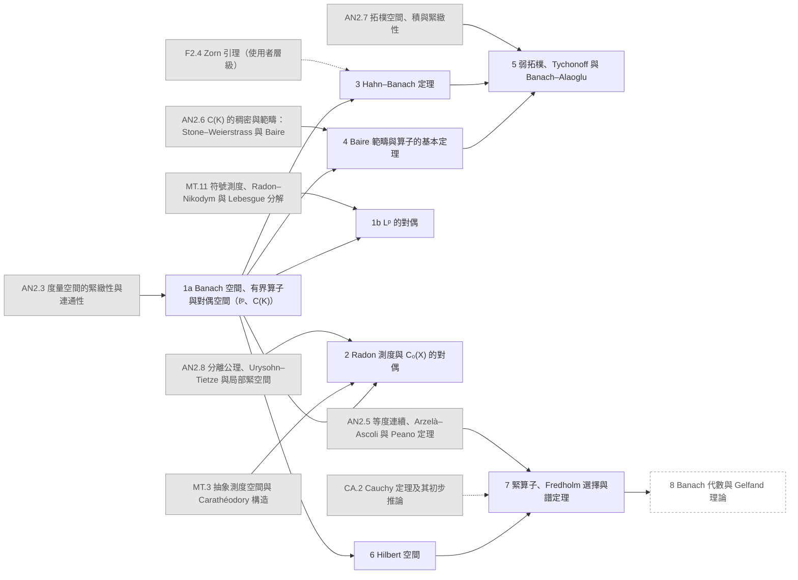

## AL4 模、表示與同調入門

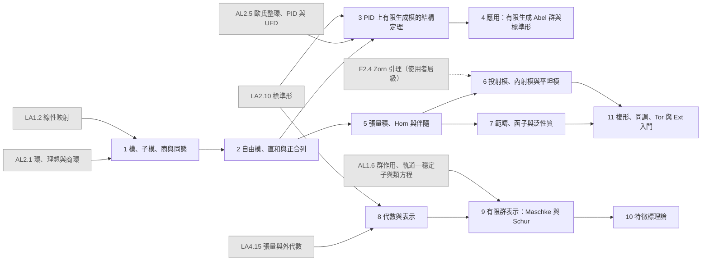

## AL5 交換代數

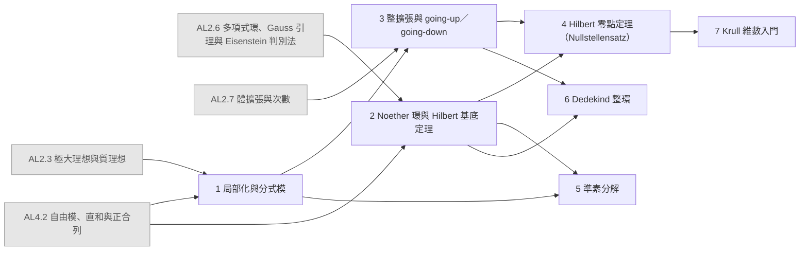

## MA 矩陣分析

```mermaid
flowchart LR
  LA2_10["LA2.10 標準形"]:::ext
  LA3_13["LA3.13 正定矩陣與奇異值分解"]:::ext
  AN2_3["AN2.3 度量空間的緊緻性與連通性"]:::ext
  AN3_3["AN3.3 線性微分方程組、矩陣指數與流"]:::ext
  CA_9["CA.9 正調和函數與 Herglotz–Nevanlinna 表示（交會章：CA × FA）"]:::ext
  MA_16["16 範數與矩陣分析"]
  MA_17["17 變分原理與交錯"]
  MA_18["18 凸性"]
  MA_19["19 非負矩陣"]
  MA_20["20 擾動理論"]
  MA_21["21 矩陣不等式"]
  MA_21b["21b Löwner 定理的 Pick 函數形式（交會章：MA × CA × FA）"]:::opt
  LA2_10 --> MA_16
  LA3_13 --> MA_16
  AN2_3 -.-> MA_16
  MA_16 --> MA_17
  MA_17 --> MA_18
  MA_18 --> MA_19
  MA_19 --> MA_20
  AN3_3 -.-> MA_21
  MA_20 --> MA_21
  CA_9 --> MA_21b
  MA_21 --> MA_21b
  classDef ext fill:#e6e6e6,stroke:#999,color:#555
  classDef opt fill:#fff,stroke:#999,stroke-dasharray:4 3,color:#555
  classDef segb fill:#f6f6fb,stroke:#99a,color:#333
```

## PR 測度論機率

```mermaid
flowchart LR
  HA_6["HA.6 ℝᵈ 上的 Fourier 變換與波動方程"]:::ext
  MT_8["MT.8 收斂模式、一致可積與弱 Lᵖ"]:::ext
  MT_11["MT.11 符號測度、Radon–Nikodym 與 Lebesgue 分解"]:::ext
  PR_1["1 測度空間上的機率"]
  PR_2["2 條件期望"]
  PR_3["3 離散時間鞅"]
  PR_4["4 弱收斂與特徵函數"]
  MT_8 --> PR_1
  MT_11 --> PR_2
  PR_1 --> PR_2
  PR_2 --> PR_3
  HA_6 -.-> PR_4
  PR_1 --> PR_4
  classDef ext fill:#e6e6e6,stroke:#999,color:#555
  classDef opt fill:#fff,stroke:#999,stroke-dasharray:4 3,color:#555
  classDef segb fill:#f6f6fb,stroke:#99a,color:#333
```

## PDE 分佈與 Sobolev 空間

```mermaid
flowchart LR
  AN2_5["AN2.5 等度連續、Arzelà–Ascoli 與 Peano 定理"]:::ext
  HA_6["HA.6 ℝᵈ 上的 Fourier 變換與波動方程"]:::ext
  MT_6["MT.6 曲面、曲面測度與散度定理"]:::ext
  MT_7["MT.7 Lᵖ 空間、摺積與磨光子"]:::ext
  MT_8["MT.8 收斂模式、一致可積與弱 Lᵖ"]:::ext
  MT_10["MT.10 有界變差、絕對連續與微積分基本定理"]:::ext
  CA_4["CA.4 環繞數、整體 Cauchy 定理與零點計數"]:::ext
  FA_1b["FA.1b Lᵖ 的對偶"]:::ext
  FA_7["FA.7 緊算子、Fredholm 選擇與譜定理"]:::ext
  PDE_1["1 分佈"]
  PDE_2["2 緩增分佈、Fourier 變換與 Plancherel"]
  PDE_3["3 插值：Riesz–Thorin、Young 與 Hausdorff–Young"]
  PDE_4["4 Sobolev 空間"]
  PDE_5["5 H¹₀、Poincaré 不等式與 Rellich 緊緻性"]
  PDE_6["6 總結：Dirichlet 問題與 Dirichlet–Laplace 特徵基"]
  MT_6 --> PDE_1
  MT_7 --> PDE_1
  HA_6 --> PDE_2
  PDE_1 --> PDE_2
  MT_8 --> PDE_3
  CA_4 -.-> PDE_3
  FA_1b --> PDE_3
  MT_10 --> PDE_4
  PDE_1 --> PDE_4
  AN2_5 --> PDE_5
  PDE_4 --> PDE_5
  FA_7 --> PDE_6
  PDE_5 --> PDE_6
  classDef ext fill:#e6e6e6,stroke:#999,color:#555
  classDef opt fill:#fff,stroke:#999,stroke-dasharray:4 3,color:#555
  classDef segb fill:#f6f6fb,stroke:#99a,color:#333
```

## GEO 仿射與射影幾何

```mermaid
flowchart LR
  LA4_15["LA4.15 張量與外代數"]:::ext
  MA_18["MA.18 凸性"]:::ext
  GEO_22["22 仿射與射影幾何"]
  LA4_15 --> GEO_22
  MA_18 --> GEO_22
  classDef ext fill:#e6e6e6,stroke:#999,color:#555
  classDef opt fill:#fff,stroke:#999,stroke-dasharray:4 3,color:#555
  classDef segb fill:#f6f6fb,stroke:#99a,color:#333
```

## NLA 計算與應用

```mermaid
flowchart LR
  MA_17["MA.17 變分原理與交錯"]:::ext
  NLA_24["24 計算與應用"]
  MA_17 --> NLA_24
  classDef ext fill:#e6e6e6,stroke:#999,color:#555
  classDef opt fill:#fff,stroke:#999,stroke-dasharray:4 3,color:#555
  classDef segb fill:#f6f6fb,stroke:#99a,color:#333
```

## ST 公理集合論

```mermaid
flowchart LR
  F2_4["F2.4 Zorn 引理（使用者層級）"]:::ext
  AL1_11["AL1.11 自由群與表現"]:::ext
  MT_1["MT.1 ℝᵈ 上的 Lebesgue 測度與可測函數"]:::ext
  ST_1["1 完整的 ZF 公理系統（重訪 F3.1）"]
  ST_2["2 序數與超限歸納"]
  ST_3["3 基數算術"]
  ST_4["4 選擇公理的等價形式"]
  ST_5["5 可構造宇宙與獨立性概觀"]
  ST_6["6 不可測集與 Banach–Tarski"]
  F2_4 --> ST_1
  ST_1 --> ST_2
  ST_2 --> ST_3
  ST_2 --> ST_4
  ST_4 --> ST_5
  AL1_11 -.-> ST_6
  MT_1 --> ST_6
  ST_4 --> ST_6
  classDef ext fill:#e6e6e6,stroke:#999,color:#555
  classDef opt fill:#fff,stroke:#999,stroke-dasharray:4 3,color:#555
  classDef segb fill:#f6f6fb,stroke:#99a,color:#333
```

圖例：灰底＝冊外來源；虛框＝選讀章；淡紫＝B 段。
