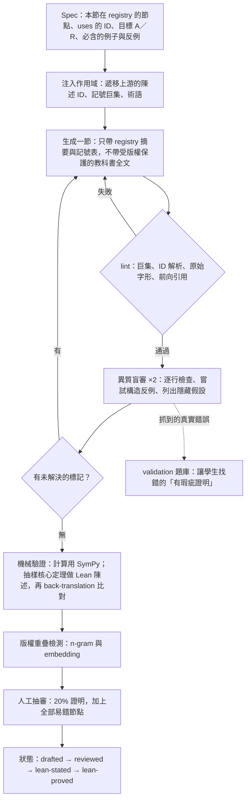
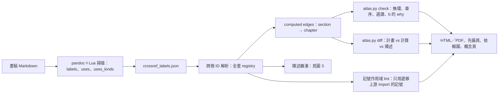
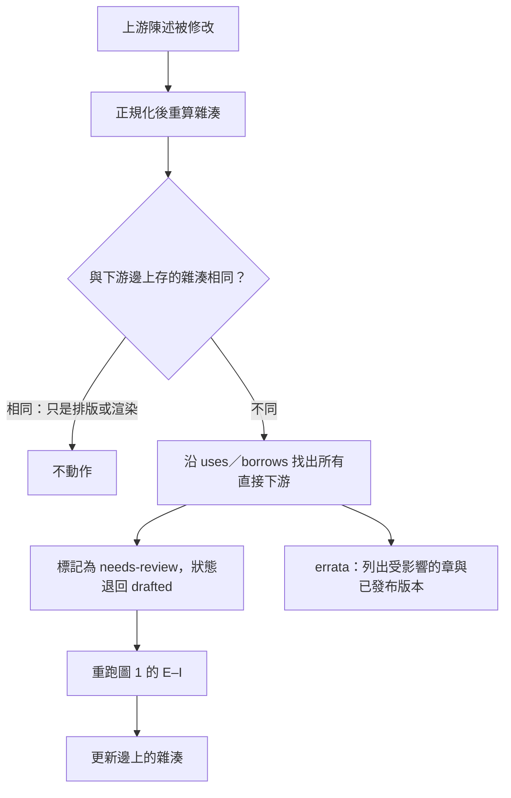
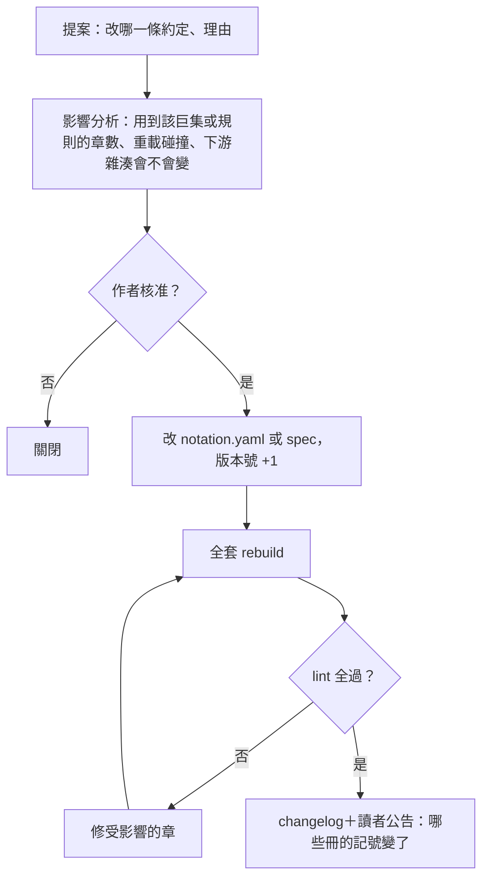
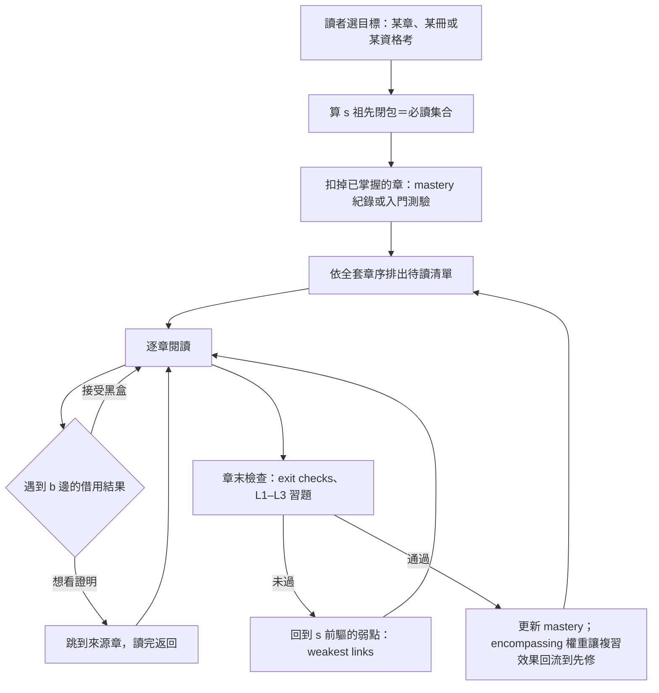

# 04 流程圖

五張圖：

1. 每節的生成與審查
2. build 管線
3. 陳述雜湊與重審
4. 約定變更治理
5. 讀者路徑

## 1. 每節的生成與審查

一次只生成一節（Ghrist 的經驗）。生成者和審查者必須來自不同的模型家族，審查者也看不到生成者的推理過程。

## 2. build 管線

## 3. 陳述雜湊與重審

每條 uses 邊都存下被引用陳述在**正規化**後的雜湊。正規化會去掉空白和排版差異，並展開巨集到語意層。所以只改記號的渲染方式，不會觸發重審。

## 4. 約定變更治理

記號約定（02）和邊型別規則（01）的變更，不能直接改檔。

## 5. 讀者路徑

