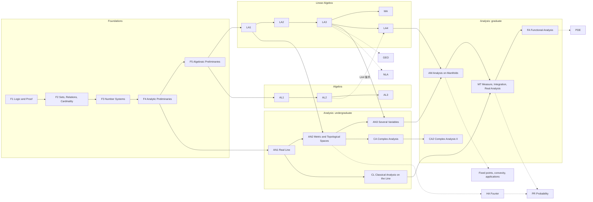

# 08 系列地圖 v2：F4 作為分析預備、線代拆冊、分析主線重畫

**狀態：提案，待作者核准；registry 尚未修改。** 本文所有 id、邊與搬動都還只是建議。核准後依〈遷移順序〉寫入 `registry/`，並在 spec/06 逐條記錄。

## Context

作者在 2026-10-25 提出四點：

1. F4 當實分析的 prelim（複分析也會用到）；參考 Lang《Basic Mathematics》補進基礎系列，範圍到 Euclidean space 與 metric 為止。
2. 線代改成像 foundations 那樣的多冊；它的 prelim 可以刪；不再有自己的網站，併進 atlas 站；後段可以依賴抽象代數。
3. 先畫分析地圖。第一輪要有 Cummings *Real Analysis* 的手感，以 Apostol *Mathematical Analysis* 為廣度主軸，並以 Tao I、Abbott、Ross、Bartle–Sherbert、Spivak、Apostol Calculus 1–2 補充。讀完應已吸收 Rudin PMA 與 Pugh。接著是複分析（Needham、Stein–Shakarchi、Ahlfors、Conway），大學部到此大致結束。之後依序是多變數與流形、Axler MIRA、泛函分析。
4. 主線與支線依依賴關係判定：主線節點不得 s/b 依賴支線節點。機率、凸分析、不動點定理，以及經濟、統計、CS 應用屬於支線（數學支線與應用葉）。動機邊（see、revisits）可以從支線指出。概念螺旋（緊緻、完備、收斂、連續）依序走過 ℝ → ℝⁿ → metric → normed/Banach → Hilbert → Lᵖ。出口標準是 UCLA／Cambridge 型資格考：Urysohn、Tietze、Tychonoff 視為前置；複分析第二層包括 harmonic/Harnack、normal families、無窮乘積／Mittag-Leffler、continuation/monodromy、Picard。版型不用註腳笑話，也不用第一人稱。

不變的約束：既有章 id 不改，新章取新 id，搬冊時 id 跟著章走，改名照 spec/06 的格式記錄；一冊等於一本書，有自己的 prefix；主線不讀支線也要讀得通。

本文由四份草稿整合而成：基礎、線代、大學部分析、複分析與研究所層。草稿之間的矛盾已經統一處理，主要是三項：F4／F5 的命名一律採 A 節的版本；Brouwer 不動點定理一律歸支線；PMA／Apostol 原本列為 gap 的部分，一律由新冊 CL 補上。

## 總覽

實線是主線的 s 邊（冊層級），虛線指向支線或應用葉。

| 系列 | 主線冊 | 支線冊／葉 |
|---|---|---|
| Foundations | F1、F2、F3、**F4 Analytic Preliminaries（改定位）**、**F5 Algebraic Preliminaries（新冊，收舊 F4.2–F4.5）** | ST |
| Linear Algebra | LA1、LA2、LA3、MA、LA4（後半要求 AL） | GEO、NLA |
| Algebra | AL1–AL5（不變） | — |
| Analysis（大學部） | AN1、**CL（新）**、AN2、AN3（縮為 4 章）、CA | HA |
| Analysis（研究所） | **CA2（新）**、**AM（新）**、MT（改名並擴充）、FA | PR、PDE、**FX（不動點／凸性／應用，暫不登記）** |

---

## A. Foundations

### A1. Lang《Basic Mathematics》的取捨

| Lang 章 | 判定 | 歸宿 |
|---|---|---|
| 1 Numbers、Interlude、14 Mappings、15 Complex | 已涵蓋 | F3.2、F3.5、F1、F2.1、F4.1；置換在 F5.3 |
| 2 Linear Equations、17 Determinants | 不需要 | LA1.3、LA2.7 |
| 3 Real Numbers（冪、根、不等式） | 收進 | F4.6；正性與絕對值已在 F3.9 |
| 4 Quadratic Equations | 已涵蓋 | F4.1 §4 |
| 5 Distance & Angles | 改寫後收進 | F4.8，以座標處理，不採綜合幾何公理 |
| 6 Isometries、10 Segments/Lines | 收進 | F4.9，推廣到 ℝⁿ，並加入凸組合與超平面 |
| 7 Area & Circumference | 不需要 | 要用到極限；π 在 AN1.10 |
| 8 Coordinates、9 Operations on Points | 收進 | F4.8 |
| 11 Trigonometry | 部分收進 | F4.10，沿用 F4.1 的 (T1)–(T5) 借用框；弧度留給 AN1 |
| 12 Analytic Geometry | 只放習題 | F4.9 的習題；二次曲線歸 LA4.14、GEO |
| 13 Functions | 收進 | F4.7；exp/log 以借用框引入 |
| 16 Induction & Summations | 部分收進 | Σ 的操作、望遠鏡和、二項式定理放進 F4.6 |

Lang 只寫到 ℝ²。作者要求到 Euclidean space 與 metric，所以另加 F4.11。技巧參考 Apostol MA 3.13–3.15、Rudin 2.15–2.18、Pugh 2.1、Tao II 1.1、Kreyszig 1.1–1.2。

### A2. F4「Analytic Preliminaries／分析預備」（prefix fd4）

F4 是 AN1、AN2、CA 的入口。章序是 F4.6 → F4.7 → F4.8 → F4.9 → F4.1 → F4.10 → F4.11。冊內保留已成稿的 F4.1，新章從 F4.6 起編，這與 AL1 從 AL1.2 起編是同一個慣例。各章照 fd 版型寫：Roadmap、Named moves、A/B/C 習題、借用框。

| 序 | id | 章名 | src | 參考 | s 邊 |
|---|---|---|---|---|---|
| 1 | **F4.6** | Inequalities, Finite Sums, and Real Powers／不等式、有限和與實數冪 | new | Lang 3、16；Spivak 1–2；Apostol Calc I §I.3–4；Abbott 1.2；B–S 2.1–2.2 | F3.9、F3.4、F2.2 |
| 2 | **F4.7** | Real Functions and Their Graphs／實函數與圖形 | new | Lang 13；Spivak 3–4；Apostol Calc I 1.3–1.5；Cummings 的病態函數表 | F4.6、F2.1；b AN1.10 |
| 3 | **F4.8** | Coordinates and Vectors in ℝⁿ／座標與 ℝⁿ 中的向量 | new | Lang 8–9；Apostol Calc I 12；Rudin 1.36–1.38；Pugh 1.5 | F4.6、F2.1 |
| 4 | **F4.9** | Lines, Convexity, and Isometries of ℝⁿ／直線、凸性與 ℝⁿ 的等距 | new | Lang 6、10、12；Apostol Calc I 13 | F4.8 |
| 5 | F4.1 | Complex Numbers／複數 | la:ch00/06（已審） | 不變 | 不變；加 see F4.8 |
| 6 | **F4.10** | Rotations, Angles, and the Complex Plane／旋轉、角與複數平面 | new | Lang 11、15；Needham 1–2；S&S I 1.1 | F4.1、F4.9 |
| 7 | **F4.11** | Metrics and Norms／度量與範數 | new | Apostol MA 3.13–15；Rudin 2.15–18；Pugh 2.1；Tao II 1.1；Kreyszig 1.1–1.2 | F4.8、F4.7、F4.6；see F4.9 |

各章要點：

- **F4.6**：Σ/Π 的操作、有限幾何和、二項式定理、Bernoulli、AM–GM、有限形式的 Cauchy–Schwarz（用 Lagrange 恆等式證）。n 次方根與有理冪用 sup 構造。估計手法寫成 Named moves，直接餵給 AN1 的 ε-N 證明。
- **F4.7**：單調、反函數、有界、函數的 sup 與 inf、floor。因式定理與「至多 n 個根」直接證明，不依賴 F5。exp 用借用框 (E1)–(E4) 引入，在 AN1.10 兌現。本章建立一張病態函數表，供 AN1 引用。
- **F4.8**：ℝⁿ 定義為 n 元組。內容包括內積、Cauchy–Schwarz（含等號條件）、範數、三角不等式、投影、夾角餘弦。不引入抽象向量空間，那屬於 LA1.1。
- **F4.9**：參數式、超平面、凸集。主定理：固定 0 的等距保持內積，因而是線性的，由正交單位行向量給出；全程不用 LA。
- **F4.10**：旋轉就是乘上單位複數；arg 不唯一，為 CA 的分支埋下伏筆；單位根；ℂ 的等距是 az+b 或 a z̄+b，其中 |a|=1。整章取 Needham 的幾何手感。
- **F4.11**：度量公理；d₁、d₂、d_∞ 及其比較；離散度量；B(S) 的 sup 度量；ℓ^∞；Hamming 距離只放習題。範數、開球、直徑、子空間度量、積度量。**不碰收斂與開集**，留給 AN2.1。概念螺旋 ℝ → ℝⁿ → metric 的前兩層在這一冊落地。

### A3. F5「Algebraic Preliminaries／代數預備」（新冊，prefix fd5）

現行 fd4 的四個代數章整批搬過來，內容不改，只改 id。

| 新 id | 舊 id | 章名 | s 邊（只改名） |
|---|---|---|---|
| F5.2 | F4.2 | Fields | F3.5 |
| F5.3 | F4.3 | Groups, Subgroups, and Homomorphisms | F2.1、F3.5 |
| F5.4 | F4.4 | Formal Polynomials | F5.2；see F4.1、F5.3 |
| F5.5 | F4.5 | Polynomials over a Field | F5.4、F3.5、F4.1、F3.10、F3.4 |

- 不設 F5.1，保留後綴方便對照。要同步改名的 plan-edges 有 AL1.2、AL2.2、AL2.5、AL2.6、LA2.6、CA.2，以及 la-edges 的計算對照。
- 遷移成本：27 處 `@fd4:` 全部在 foundations repo 內。`fd4/src/ch02–05` 搬到 `fd5/` 並重新編為 ch01–04，原處留錨點。books.json 的 `algebraic-preliminaries` 改指 fd5；fd4 改用 `analytic-preliminaries`，舊路徑保留為 alias。
- F5 跨冊只依賴 F4.1。AN、CA 都不需要 F5；LA1 與 AL1 需要。

### A4. 下游的邊

| 章 | 改動 |
|---|---|
| AN1.1 | 不動（已成稿），加 `revisits: [F4.6]` |
| AN1.2／AN1.5 | 加 `s: F4.6`／`s: F4.7` |
| AN1.10 | 加 `revisits: [F4.7, F4.10]`，兌現 exp 與三角的借用框 |
| AN2.1 | 改為 `s: [AN1.2, AN1.5, F4.8, F4.11]`，**刪掉** `s: LA1.1` 與 `b: LA3.11` |
| CA.1 | 改為 `s: [F4.1, F4.10, AN1.10, AN2.3]` |
| LA1.1、LA3.11 | 加 `see: [F4.8]` |

後果：讀序變成 F1 → F2 → F3 → F4 → AN1，「fd2 之後平行讀 AN1」的路線取消（決策 2）。

---

## B. Linear Algebra：拆成七冊，併入 atlas 站

### B1. 冊與章（章 id 全部不變；每冊自第 1 章編號）

`linear-algebra` repo 改成子目錄結構 `la1/ … nla/`，與 foundations 相同。

| 冊（prefix，subdir） | 章（atlas id ← 書稿） | 備註 |
|---|---|---|
| **la1** *Spaces and Maps*（`spaces-and-maps`） | LA1.0 ← ch00 §09；LA1.1–LA1.5 ← ch01–05 | 硬依賴 F2.1、F2.5、F5.2、F5.4；§1.8 的 Zorn 改為借用 F2.4 |
| **la2** *Determinants and the Structure of Operators* | LA2.6–LA2.10 ← ch06–10 | LA2.6 revisits F5.5；LA2.7 硬依賴 F5.3（sign） |
| **la3** *Inner Products and Spectral Theory* | LA3.11–LA3.13 ← ch11–13 | 線代主線的終點 |
| **la4** *Forms and Multilinear Algebra* | LA4.14、LA4.15 ← ch14–15；暫置 AL4.8 ← ch23 | 後半要求 AL（B4） |
| **ma** *Matrix Analysis* | MA.16–MA.21 ← ch16–21；MA.21b（已登記） | 只依賴 la3 與 F4.1 |
| **geo** *Affine and Projective Geometry* | GEO.22 ← ch22 | 支線葉 |
| **nla** *Computation and Applications* | NLA.24 ← ch24 | 支線葉 |

- **刪除 ch00 Preliminaries**，各節的去處：§01–02 → F1.5，§03–04 → F2.1，**§05 → F2.5**，§06 → F4.1，§07 → F5.2，§08 → F5.4，§09 → LA1.0，§10 → F5.3。
- §05 是一處修正：fd2 重切之後，等價關係與商集歸到 F2.5。因此要改三處：`chapters.yaml` 把 F2.2 的 `src: la:ch00/05` 移到 F2.5；`import_la.py` 的 `CH00["05"]` 改成 `"F2.5"`；計算邊 LA1.4 ← F2.2（7 條，都是商空間）改指 F2.5。
- 每冊依自己用到的 macro 產生 Notation 頁。跨冊的 reading-paths（computer-science、economics）改由 atlas flows（spec/04）承載。

### B2. Label 與網址

1. 一個陳述一個 ID，label 不改名。跨冊引用改寫成 `@la1:thm-x` 這種形式，沿用 foundations 拆冊時的改寫工具，再由 lint 守住。
2. ch00 的 86 個 label 依 `chapter-constraints.yaml` 的 `takes` 由 F 章接手，目前只寫了 2 條，要補齊。在 F 章接手之前，la1 留一頁不編號的錨點頁，每個錨點連到 `@fdN:` 的對應位置。
3. 舊網址：節的層級用 config `redirects` 的目錄規則產生 stub；錨點由 stub 的 JS 保留 `location.hash`；ch00 另外產生一張 `moved-ids` 對照表。
4. 書稿與 constraints 裡寫死的章節號（例如「Section 14.6 of the linear algebra book」）一律改成 label 引用。

### B3. 併入 atlas 站

- **books.json**：`la` 一筆換成七筆，格式照 fd1（`series: "Linear Algebra"`、`overlay.short-urls`）。geo、nla 在 landing 上標為支線。PDF 由 library 組裝。
- **landing 圖**：畫出 LA1 → LA2 → LA3 主線，LA4、MA 接在 LA3 之後，GEO、NLA 用虛線。caption 改成「F5 → LA1」。
- **引擎**，兩個小改動，都附測試：
  - `write_redirects` 接受絕對網址的 target，並保留 hash。
  - `library.py` 加 `redirects` 鍵，處理舊的 `linear-algebra/` 子目錄一對七的轉址。
- **linear-algebra.akizumifox.com**：GitHub Pages 沒有 301，所以 `AkizumiFox/linear-algebra` 的 Pages repo 改成 stub 站，每個舊頁跳到 `https://atlas.akizumifox.com/<subdir>/…#hash`。stub 帶 `noindex`，sitemap 清空，至少保留一年（決策 9）。

### B4. 明說依賴抽象代數的章

主線（la1–la3、ma）不依賴 AL，F5.3 就夠用。以下要加邊，並在章首寫明「需要 AL…」：

| 章／節 | 邊 |
|---|---|
| LA2.10 §05–07（rational canonical form、Smith normal form） | 保持自足（F5.5、LA2.6）；加 `see: [AL2.5]` |
| LA4.14 §10 classical groups、§12 Clifford | `s: [AL1.5, AL1.6, AL2.1]` |
| LA4.15 §06–08、§10（tensor/exterior algebra 作為商） | **`b: [AL2.1]`，scope 限這幾節**（決策 11） |
| GEO.22 §04、§07 | `s: [AL1.6]` |
| AL4.8 ← ch23 | `s: [AL2.1, AL1.6]`；暫時寄放在 la4（`hosted: la4`），AL4 動筆時搬走（決策 10） |

LA4.15 對 AL2.1 用 b 而不用 s，原因是 AN3.6 s-依賴 LA4.15（交錯多線性形式，§01–05）。如果用 s，AM 與後面整條分析主線都會遞移地要求 AL2.1。

---

## C. Analysis：大學部主線

### C0. 結論

- **AN1 不拆冊**，維持 Cummings 的骨架，共 11 章，另加選讀章 AN1.12。
- **Apostol 有而 AN1 沒有的廣度，另開新冊 CL**。CL 屬主線，可以和 AN2 平行讀。
- **AN3 縮成 4 章**（AN3.1–AN3.4，對應 PMA 9）。AN3.5–AN3.7 搬到 AM。
- **Lebesgue 理論整體延後到 MT**。大學部只做到測度零與 Lebesgue 判準（CL.2 給完整證明），再由 HA.9 搭橋（決策 4）。
- **大學部以 CA 收尾。**

### C1. AN1 *Analysis on the Real Line*（12 章，1 章選讀）

- AN1.1–AN1.11 的 id、章名、src 都不動。
- AN1.5 補一節：不連續點的分類，單調函數的不連續點至多可數（Apostol 4.22–23、B–S 5.6）。CL.1 要用到這一節。
- AN1.8 §6 維持綱要，完整證明往後指向 CL.2，作為「hook paid later」。
- **AN1.12 A Gallery of Pathological Functions**（opt，新章）：Thomae、Volterra 型函數、Cantor 函數、處處不可微函數、Peano 曲線、e^{-1/x²}。它收束 F4.7 的病態函數表。因為是選讀章，任何 s 邊都不得依賴它。
- Cummings 式工具：
  - 伏筆與回收：Cantor 集 → CL.1；Fourier 危機 → HA；1/(1+x²) 的收斂半徑 → CA.1。
  - Scratch Work／Proof Idea 逐冊減量：AN1 完整提供，CL 減半，AN2 起只留 Proof Idea。
  - 用失敗動機引入定義。
  - 章末附 List of Results。

### C2. CL *Classical Analysis on the Line*（新冊，prefix cl，6 章，約 300 頁）

| id | 章名 | 參考 | s 邊 |
|---|---|---|---|
| CL.1 | Functions of Bounded Variation and Rectifiable Curves | Apostol 6；Pugh 3 習題；Cantor 函數 | AN1.5、AN1.6、AN1.8 |
| CL.2 | The Riemann–Stieltjes Integral（章末：Lebesgue 判準的完整證明） | Apostol 7、PMA 6、Ross §35、Tao I 11.8、Abbott 7.6 | CL.1、AN1.8 |
| CL.3 | Integrals with a Parameter, Euler Summation, and the Gamma Function | Apostol 7.5、7.17–20；PMA 8（Γ、Stirling）；Abbott 8.3–4；Spivak 19 | CL.2、AN1.9、AN1.10 |
| CL.4 | Double Series, Infinite Products, and the Euler Product | Apostol 8.20–25；Pugh 3 | AN1.3、AN1.10 |
| CL.5 | Summability and Tauberian Theorems | Apostol 8.26、9.21–23（只講 Littlewood 的 O(1/n) 版本） | CL.4、AN1.10 |
| CL.6 | The Gauge Integral（opt） | B–S 10、Abbott 8.1 | CL.2 |

新的動機邊與回收邊：

- HA.2 see CL.5（Fejér 就是 Cesàro）
- HA.3 b CL.1（scope 只限 Dirichlet–Jordan 那一節）
- MT.2 revisits CL.2
- MT.10 revisits CL.1
- CA.7 revisits CL.4
- CA.13 revisits CL.3
- PR.1 see CL.2（從支線指出的動機邊，合規）

### C3. AN2、AN3

- **AN2 *Metric and Topological Spaces*（8 章，不動）**：
  - AN2.1–AN2.6 對應 PMA 2–4、7 與 Pugh 2、4。
  - AN2.6 補 Bernstein 證明作為 Weierstrass 逼近定理的第一證，Stone–Weierstrass 作第二證。
  - AN2.7–AN2.8（Urysohn、Tietze、有限積）留在本冊，因為資格考把它們當作前置。Tychonoff 的完整證明仍在 FA.5。
- **AN3 *Analysis in Several Variables*（4 章）**：
  - AN3.1–AN3.4 不動。
  - AN3.2 §5 的秩定理由選讀改為必讀（PMA 9.32）。
  - AN3.4 §6 只陳述非線性變數變換，證明放在 AM.1，原本放 MT.5。

### C4. 終點判準

讀完 AN1、CL、AN2、AN3、CA 之後，應達到以下覆蓋：

- PMA 1–7、9 與 Pugh 1–5（不含 forms、Stokes、Brouwer）的每一個定理，都已在主線上證過或以習題出現。
- Apostol MA 1–9、12–14 全部覆蓋。
- PMA 8 的 Fourier 部分與 Apostol 11 由支線 HA.1–HA.5 覆蓋。這幾章只依賴主線，建議在大學部讀（決策 5）。

### C5. 延後項目

| 延後內容 | 去處 | 理由 |
|---|---|---|
| Lebesgue 積分（Apostol 10、15；PMA 11；Pugh 6） | MT | 同一概念只有一個定義點；螺旋發生在空間的層次，不在積分的定義上 |
| 子流形、形式、Stokes（PMA 10） | AM | 作者的順序：多變數與流形在 CA 之後 |
| Brouwer、Schauder、Kakutani | FX 支線 | 依作者第 4 點，不動點定理屬支線；主線只有 Banach 壓縮（AN2.4） |
| Fourier 的 Lᵖ 與極大函數 | HA.6+、MT.9 | — |
| C(K) 之後的 Banach／Hilbert 層 | MT（FA.1a、FA.6） | 螺旋的下一圈 |

---

## D. Analysis：複分析與研究所層

### D1. CA *Complex Analysis*（prefix ca，T1，主線；大學部最後一冊）

| 序 | id | 章名 | 來源 | 參考 |
|---|---|---|---|---|
| 1 | CA.1 | Holomorphic Functions and Power Series | ab:55 | S&S 1、Ahlfors 2、Needham 4–5 |
| 2 | **CA.10** | Möbius Transformations and the Riemann Sphere | new | Needham 3、6；Ahlfors 3.3；Conway III.3 |
| 3 | CA.2 | Cauchy's Theorem and Its First Consequences | ab:56 | S&S 2、Ahlfors 4.1–3 |
| 4 | CA.3 | Laurent Series, Singularities, and Residues | ab:57 | S&S 3、Ahlfors 4.5、5.1 |
| 5 | CA.4 | Winding Numbers, the Global Cauchy Theorem, and Counting Zeros | ab:58 | Needham 7–8、Conway IV–V |
| 6 | CA.6 | **改名** Harmonic Functions and the Poisson Integral | ab:60 前半 | Ahlfors 4.6、Needham 11–12 |
| 7 | CA.5 | Conformal Maps, Normal Families, and the Riemann Mapping Theorem | ab:59 | S&S 8、Ahlfors 6.1、Conway VII.2 |

- 新增邊：
  - CA.10 s [CA.1, F4.1]，see AN2.1
  - CA.4 see CA.10
  - CA.5 加 s CA.6（Schwarz 反射用調和延拓，依 Ahlfors 6.5 的順序）
- 冊外依賴：F4.1、F4.10、AN1.10、AN2.3、AN2.5，以及 b AN3.1、b AN3.4。不依賴 HA、MT、FA。

### D2. CA2 *Complex Analysis II: Global Theory*（新冊，prefix ca2，T2，主線）

| 序 | id | 章名 | 來源 | s 邊 |
|---|---|---|---|---|
| 1 | **CA.11** | Subharmonic Functions, Harnack, and the Perron Method | new（ab:60 後半） | CA.6、CA.5 |
| 2 | CA.7 | Infinite Products and Entire Functions | ab:61 | 不變；revisits CL.4 |
| 3 | **CA.12** | Runge's Theorem, Mittag-Leffler, and Simply Connected Regions | new | CA.4、CA.7 |
| 4 | **CA.13** | The Gamma and Zeta Functions | new | CA.7、CA.8a；revisits CL.3 |
| 5 | CA.8a | Analytic Continuation and Monodromy | ab:62 | 不變 |
| 6 | **CA.14** | Bloch, Landau, Schottky, and the Picard Theorems | new | CA.5、CA.8a |
| 7 | **CA.15** | Elliptic Functions（opt） | new | CA.7；see CA.13 |
| 8 | CA.8b | **改名** Picard's Theorems via Theta Functions（opt，CA×HA 交會章） | ab:62 | 不變 |

- 走 Bloch 路線，主線因此有 Picard 定理，而且不需要 HA。
- 主要參考是 Conway I 與 Ahlfors 後半。
- CA.9（Herglotz–Nevanlinna）搬到 FA，因為它依賴 FA.2 與 FA.5。

### D3. AM *Analysis on Manifolds*（新冊，prefix am，T2，主線）

| 序 | id | 章名 | 來源 | 參考 | s 邊 |
|---|---|---|---|---|---|
| 1 | **AM.1** | Partitions of Unity, Improper Integrals, and Change of Variables | new | Munkres AoM 4、Spivak CoM 3、Pugh 5 | AN3.2、AN3.4 |
| 2 | AN3.5 | Submanifolds of ℝⁿ and Tangent Spaces | new（搬冊） | Munkres 5、Hubbard 3 | 不變 |
| 3 | AN3.6 | Differential Forms and the Exterior Derivative | new（搬冊） | Munkres 6、PMA 10 | 不變（AN3.1、LA4.15） |
| 4 | AN3.7 | Integration on Manifolds and Stokes' Theorem | new（搬冊） | Munkres 7、PMA 10、Pugh 5 | 加 AM.1 |
| 5 | **AM.2** | Closed and Exact Forms: Poincaré Lemma and de Rham Cohomology of Punctured ℝⁿ | new | Munkres 8、Tu 24–25 | AN3.7 |
| 6 | **AM.3** | Abstract Smooth Manifolds, Vector Fields, and Flows（seg B） | new | Lee ISM 1–3、8–9 | AN3.5、AN2.7、AN3.3 |

- AN3.5–AN3.7 取消 seg B 標記。
- 原本的「AN3.7 revisits MT.6」反轉為「MT.6 revisits AN3.7」。
- AM.2 對 FX 支線的 Brouwer 只留 see 邊。

### D4. MT *Measure, Integration, and Real Analysis*（改名，prefix mt 不變；MIRA 1–10 的骨架）

章序：HA.9 → MT.1 → MT.2 → MT.3 → MT.4 → MT.5 → MT.6 → FA.1a → FA.4 → FA.3 → MT.7 → MT.8 → MT.9 → MT.10 → FA.6 → MT.11 → FA.1b → **FA.9** → FA.7

| MIRA | atlas 章 |
|---|---|
| 1 Riemann 積分及其不足 | HA.9（搬入 MT，改名為 Riemann Integration and Its Failures） |
| 2–3 測度、積分、極限定理 | MT.1（補 Egorov、Luzin）、MT.3、MT.2 |
| 4 極大函數、微分 | MT.9；MT.10（AC／BV） |
| 5 乘積測度 | MT.4、MT.5 |
| 6 Banach、Baire | FA.1a、FA.3、FA.4 |
| 7 Lᵖ | MT.7、MT.8 |
| 8 Hilbert | FA.6 |
| 9 實測度與複測度 | MT.11、FA.1b |
| 10 Hilbert 空間上的算子 | **FA.9 Bounded Operators on Hilbert Space**（new，s FA.6）、FA.7（加 s FA.9） |
| 11 Fourier、12 機率 | HA.10、PR.1（支線） |

- HA.9 的邊改為 s [AN1.8, AN1.9, AN2.6, AN1.4]。原本的 s HA.3 是主線依賴支線，違規，所以刪掉，改成 HA.3 see HA.9。
- MT.1 的 see HA.9 升為 s。
- 保留 Stein–Shakarchi 式的「ℝᵈ 先具體構造」。

### D5. FA *Functional Analysis*（prefix fa，T2，主線）

| 序 | id | 章名 | 來源 | s 邊 |
|---|---|---|---|---|
| 1 | FA.2 | Radon Measures and the Dual of C₀(X) | ab:66 | 不變 |
| 2 | FA.5 | Weak Topologies, Tychonoff, and Banach–Alaoglu | ab:69 | 不變 |
| 3 | **FA.10** | Reflexivity, Uniform Convexity, and Separability | new | FA.5、FA.1b |
| 4 | **FA.11** | Locally Convex Spaces and Fréchet Spaces | new | FA.5、FA.4 |
| 5 | FA.8 | Banach Algebras and Gelfand Theory（去掉 opt） | ab:72 | 不變 |
| 6 | **FA.12** | The Spectral Theorem for Bounded Normal Operators | new | FA.8、FA.9 |
| 7 | **FA.13** | Unbounded Operators and Self-Adjointness | new | FA.12 |
| 8 | **FA.14** | Fredholm Operators and the Index | new | FA.7、FA.4 |
| 9 | CA.9 | Positive Harmonic Functions and Herglotz–Nevanlinna（opt，搬入） | new | 不變 |

參考書：Brezis、Conway FA、Rudin FA。Kreyszig 是低門檻的對照讀物。PDE.1 加 see FA.11（決策 13）。

### D6. 支線

| 支線 | 內容與邊 |
|---|---|
| **HA** Fourier（branch 改為 side） | 主線對它只有軟邊：FA.4 see HA.1、FA.6 see HA.3、CA.6 revisits HA.2。新章 **HA.10** Fourier Analysis in L¹ and L²，s [MT.7, FA.6, HA.3]。HA.3 補 Riemann 局部化與 Dirichlet–Jordan 判準 |
| **PR** 機率 | PR.1 s [MT.4, MT.8]。新章 **PR.5** Brownian Motion，s [PR.3, PR.4, FA.6] |
| **PDE** | 現有的邊都合規（指向主線，或支線指向支線） |
| **FX** 不動點、凸性與應用 | Brouwer（see AM.2）、Schauder（AN2.5、FA.5）、Kakutani、凸分析、經濟應用。先在本文記錄；等寫出第一章時再登記 volume（決策 12） |

S&S IV 的機率、多複變、振盪積分，以及 Kreyszig 的應用章節，全部歸支線。

---

## E. 覆蓋檢查

### E1. 新的 exam targets（`registry/exam-targets.yaml`）

| id | 名稱 | chapters |
|---|---|---|
| `pma` | Rudin, *Principles of Mathematical Analysis* | F3.3、F4.1、F5.5、AN1.1–AN1.10、CL.2、CL.3、AN2.1、AN2.3–AN2.6、AN3.1、AN3.2、LA2.7、AN3.6、AN3.7、AM.1、MT.1、MT.2、MT.7；支線覆蓋：HA.1–HA.3 |
| `pugh` | Pugh, *Real Mathematical Analysis* | F2.3、F3.3、AN1.1、AN1.3、AN1.4、AN1.7–AN1.10、CL.4、AN2.1–AN2.6、AN3.1、AN3.2、AN3.4、AM.1、AN3.6、AN3.7、MT.1、MT.2、MT.4、MT.9、MT.10（Brouwer 不列入） |
| `apostol-ma` | Apostol, *Mathematical Analysis* 2e | F4.1、F2.3、AN1.1、AN1.3–AN1.10、CL.1–CL.5、AN2.1、AN2.3、AN2.4、AN2.6、AN3.1、AN3.2、AN3.4、CA.1–CA.5、CA.7、MT.1、MT.2、MT.4、MT.5、MT.7、MT.10；支線覆蓋：HA.1–HA.3、HA.5 |
| `mira` | Axler, *Measure, Integration & Real Analysis* | HA.9、MT.1–MT.4、MT.7、MT.9、MT.11、FA.1a、FA.1b、FA.3、FA.4、FA.6、FA.9、FA.7；支線覆蓋：HA.10、PR.1 |
| `ahlfors` | Ahlfors, *Complex Analysis* 3e | CA.1、CA.10、CA.2、CA.3、CA.4、CA.6、CA.5、CA.11、CA.7、CA.12、CA.13、CA.15、CA.8a、CA.14 |

現有的 `complex` 改為 [CA.1–CA.6, CA.10, CA.7, CA.12, CA.11, CA.8a, CA.14]，並加入考綱條目：Harnack（CA.11）、normal families（CA.5）、Mittag-Leffler（CA.12）、monodromy（CA.8a）、Picard（CA.14）。Picard 不再排除。

各 target 的 `items` 照 complex 的格式，逐條對應考綱；PMA、Apostol 原本列的 gap（R–S、BV、Cesàro、Γ）分別由 CL.2、CL.1、CL.5、CL.3 填上。

### E2. atlas.py 要加的驗證

目前 `check` 對 exam targets 只核對章 id 是否存在。建議加三項，各附測試：

1. **主線純度**（error）：主線章（所屬 volume 的 branch 不是 side）不得以 s 或 b 邊指向 side volume 的章。see、revisits 不受限。這一項把作者第 4 點變成機器可驗證的規則。
2. **target 的分層**：exam target 新增兩個欄位，`level: undergrad | grad` 與 `branch_cover: [...]`。
   - `level: undergrad` 的 target，其 `chapters` 的 s 祖先閉包不得含有 T2 以上的冊。
   - `branch_cover` 裡的章不計入必讀閉包，但要列在 report.md。
3. **條目完整**：`items` 的每一條都要有 `ch`，否則就是 `gap`。report.md 新增一張「target × gap」表，大學部 target 的 gap 數應為 0。

`stats` 也新增「冊層級的讀序」：把 volumes.yaml 的順序與 s 邊比對。這個檢查已經存在，新冊加入後照用。

---

## F. 遷移順序

各步驟都在新分支上進行，合併由作者執行。照 usage 的限制，一次只跑一個 workflow。

1. **registry（只動 atlas）**，依序做：
   - 新增 volumes：F5、CL、CA2、AM；F4 改名；MT 改名；HA 的 branch 改為 side。
   - chapters：新章、搬冊（AN3.5–7 → AM；CA.7、CA.8a、CA.8b → CA2；CA.9 → FA；HA.9、FA.1a、FA.1b、FA.3、FA.4、FA.6、FA.7 → MT）、改名（F4.2–5 → F5.2–5、CA.6、CA.8b、HA.9）。
   - plan-edges：依本文各節修改。
   - exam-targets：依 E1。
   - 加上 E2 的檢查。
   - 在 spec/06 逐條記錄。
   - Gate：`atlas.py all` 通過，主線純度沒有違規。
2. **foundations**：拆出 fd5（搬四章、改 `@fd5:`），fd4 換 subdir，更新 books.json。之後依序寫 F4.6 → F4.7 → F4.8 → F4.11 → F4.9 → F4.10。AN1.2 起要用 F4.6，所以 F4.6 最先寫。
3. **an1 續寫**：AN1.2 起照新邊；AN1.5 補一節。CL 的 blueprint 與 AN1 同步建立。
4. **引擎**：加 `write_redirects` 的絕對 target 與 `library.py` 的 `redirects`，發 rc 版。
5. **LA 拆冊**：
   - `git mv` 成七冊，改寫跨冊引用。
   - Gate：七冊的 `check` 都通過，`import_la.py` 的輸出與拆冊前沒有差異。
   - 完成後切換預覽站，最後把舊網域換成 stub 站。
   - 第一次建置要全量重建，約 40 分鐘，排在 usage 寬裕的時段。
6. **分析 blueprints**：CA/CA2、AM、MT、FA 依本文改寫 `analysis-series/*/authoring/blueprints`。
7. ch00 的 label 由 F 章接手之後，刪掉 la1 的錨點頁。

---

## G. 待作者決定

| # | 決策 | 選項 | 建議 |
|---|---|---|---|
| 1 | F4／F5 的命名 | (a) F4 改為 Analytic Preliminaries，舊代數章搬到新的 F5；(b) fd4 維持代數預備，分析預備另開 F5 | **(a)**。它符合「F4 是實分析的 prelim」；搬動只影響 foundations repo 內的 27 處引用 |
| 2 | AN1 是否依賴 F3、F4（AN1.2 s F4.6） | (a) 接受，讀序為 F1→F2→F3→F4→AN1；(b) F4.6、F4.7 只從完備有序體公理出發，保住「fd2 之後就能讀 AN1」 | **(a)**。(b) 要與 F3.9 重複一節 |
| 3 | Apostol 的廣度放在哪裡 | (a) 新冊 CL（6 章）；(b) 分散到 AN1、AN2 各補一節 | **(a)**。AN1 維持 Cummings 的節奏，CL 可以和 AN2 平行讀 |
| 4 | 大學部是否先看一次 Lebesgue | (a) 延後到 MT，大學部只到 Lebesgue 判準；(b) 走 Apostol 10 的 Riesz 路線先看一次 | **(a)**。同一概念只有一個定義點 |
| 5 | HA 的地位 | (a) 支線冊，大學部 target 以 `branch_cover` 計入 HA.1–HA.5；(b) HA.1–HA.5 劃為主線 | **(a)**。主線沒有任何章硬依賴 HA |
| 6 | 複分析拆冊 | (a) CA（大學部）＋ CA2（資格考第二層），Picard 走 Bloch 路線進主線；(b) 維持單冊 | **(a)** |
| 7 | Brouwer 放哪裡 | (a) FX 支線，AM.2 只留 see；(b) AM 的選讀章 | **(a)**。符合作者第 4 點 |
| 8 | MT 是否照 MIRA 重劃 | (a) MT 吸收 FA.1a、FA.1b、FA.3、FA.4、FA.6、FA.7、HA.9，FA 只留研究所層；(b) MT、FA 照舊 | **(a)**。符合作者「MIRA → 泛函」的順序 |
| 9 | LA 拆成七冊並退役舊網域 | (a) 七冊，舊網域改成 stub 站保留一年；(b) 拆冊但舊網域照常運作 | **(a)** |
| 10 | AL4.8（ch23）的去處 | (a) 暫時寄放在 la4，AL4 動筆時搬走；(b) 現在就從線代下架 | **(a)** |
| 11 | LA4.15 對 AL2.1 的邊型 | (a) b 邊，scope 限 §06–08、§10；(b) s 邊 | **(a)**。否則 AM 以下整條分析主線都要求 AL2.1 |
| 12 | FX 支線何時登記 | (a) 寫出第一章時再登記 volume；(b) 現在就登記空冊 | **(a)** |
| 13 | PDE.1 的半範數 | (a) 自足，只加 see FA.11；(b) 改為 b FA.11 | **(a)**。支線不受主線改版影響 |
| 14 | 跨冊 reading-paths | (a) 改由 atlas flows 承載；(b) 留在 la1 的 config | **(a)** |
